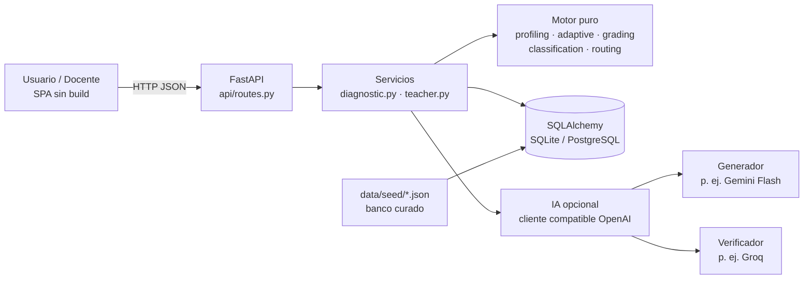

# Ratio · Diagnóstico jurídico adaptativo

> *¿Cómo saber qué necesita aprender una persona antes de empezar a enseñarle?*

**Ratio** valora el conocimiento de una persona en derecho constitucional o laboral colombiano, encuentra la **raíz** de sus vacíos y genera una **ruta de aprendizaje personalizada**, justificada con evidencia y lista para **revisión docente**.

El nombre tiene doble sentido: *ratio decidendi* (el núcleo de una decisión jurídica) y *ratio* como medida, que es lo que la herramienta hace con lo que sabes.

La herramienta **evalúa y orienta, no enseña**: durante el diagnóstico no hay retroalimentación. Al final se entrega el resultado y la ruta.

---

## 1. Cómo correrla

**Opción A — un comando (macOS/Linux o Windows)**
```bash
./run.sh          # Windows: run.bat
```
Crea un entorno virtual, instala dependencias, ejecuta las pruebas y abre el servidor en **http://localhost:8000**.

**Opción B — manual**
```bash
cp .env.example .env
cd backend
pip install -r requirements-dev.txt
python -m pytest -q                      # 24 pruebas
uvicorn app.main:app --reload --port 8000
```

**Opción C — Docker con PostgreSQL**
```bash
cp .env.example .env
docker compose up --build
```

- Usuario: http://localhost:8000
- Administración: inicia sesión con `admin@ratio.local` / `admin-demo` (cámbialos en `.env`: `ADMIN_EMAIL`, `ADMIN_PASSWORD`)
- Documentación interactiva de la API: http://localhost:8000/docs

No necesita claves de IA para funcionar: sin ellas usa el banco curado y la calificación por rúbrica.

---

## 2. Cómo cumple el reto

| Requisito del reto | Dónde está |
|---|---|
| **1. Perfilar** (formación, intereses, objetivo, tiempo) | Formulario de perfil → `engine/profiling.py` decide enfoque, nivel inicial y techo de dificultad |
| **2. Valorar** con evaluación adaptativa, fortalezas y vacíos por subtema | `engine/adaptive.py`: escalera por subtema + exploración de prerrequisitos |
| **3. Clasificar** (básico/intermedio/avanzado; técnico vs. práctico) | `engine/classification.py`: nivel por subtema y global, confianza de la medición |
| **4. Diseñar** la ruta (subtema, objetivo, prioridad, fuentes) | `engine/routing.py`: orden por dependencias, horas y semanas según el tiempo disponible |
| **5. Justificar y marcar** | Cada paso trae la evidencia (preguntas, errores, nivel) y marcas de riesgo para el docente |
| Revisión docente | Panel docente: revisar respuestas, anotar pasos, quitar pasos, aprobar |
| No producir contenido formativo | La API nunca envía la clave ni el error asociado al usuario mientras responde (probado en `test_questions_never_leak_answers_or_feedback`) |

### Qué lo hace distinto de un cuestionario

1. **Cada opción incorrecta diagnostica un error concreto.** No dice solo "falló", sino "confunde el fuero de maternidad con el fuero sindical".
2. **Busca la raíz.** Si la persona falla en nivel básico, el motor explora el subtema prerrequisito (por ejemplo, de *Estabilidad reforzada* baja a *Terminación del contrato*).
3. **Es explicable.** Cada decisión del motor queda en una traza legible ("Falló en nivel 2: baja al nivel 1 para ubicar el concepto previo").
4. **Desconfía de sí mismo.** Marca para el docente las fuentes en transición normativa, las preguntas de IA, las calificaciones automáticas, la evidencia insuficiente y los resultados inconsistentes (fortaleza en un tema cuyo prerrequisito es un vacío).

---

## 3. Arquitectura



```
ratio/
├── backend/
│   ├── app/
│   │   ├── main.py            # arranque, crea tablas y sincroniza el banco
│   │   ├── config.py          # Settings por variables de entorno
│   │   ├── db.py · models.py  # persistencia (SQLAlchemy 2)
│   │   ├── schemas.py         # contratos de la API (Pydantic)
│   │   ├── seed.py            # carga y valida el banco semilla
│   │   ├── engine/            # lógica pura, sin BD ni IA: se prueba aislada
│   │   ├── ai/                # cliente, prompts y servicios de IA
│   │   ├── services/          # orquestación (casos de uso)
│   │   └── api/routes.py      # endpoints delgados
│   └── tests/test_ratio.py
├── frontend/                  # index.html · styles.css · app.js (sin dependencias)
├── data/seed/                 # constitucional.json · laboral.json
├── Dockerfile · docker-compose.yml · run.sh · run.bat · .env.example
```

### Patrones de diseño aplicados

| Patrón | Dónde | Para qué |
|---|---|---|
| Arquitectura en capas | api → services → engine / db / ai | Cada capa se cambia sin tocar las demás |
| Núcleo funcional puro | `engine/` | El motor no conoce HTTP, BD ni IA: pruebas rápidas y deterministas |
| Strategy | `KeyGrader`, `RubricKeywordGrader`, `AIRubricGrader` | Calificar según el tipo de pregunta y la IA disponible |
| Adapter | `ai/client.py` | Un solo cliente para Gemini, Groq, OpenRouter, Ollama o Claude |
| Settings / 12-factor | `config.py`, `.env` | Mismo código en local, demo y producción |
| Graceful degradation | IA opcional | Sin claves o con límite agotado (HTTP 429), la app sigue funcionando |
| Data-driven content | `data/seed/*.json` | Abogados editan preguntas sin tocar código; el validador revisa su calidad |
| Audit trail | traza del motor + respuestas | Justificación de cada paso de la ruta |

### Escalabilidad y portabilidad

- **Base de datos:** SQLite para la hackathon; PostgreSQL cambiando solo `DATABASE_URL` (Docker Compose incluido).
- **Estado del diagnóstico:** se guarda en la BD, no en memoria. El servidor es *stateless* y se pueden correr varias instancias detrás de un balanceador.
- **Nueva área del derecho:** se agrega un JSON en `data/seed/` (o se generan preguntas con IA desde el panel) y se reinicia. El validador rechaza preguntas sin fuente, sin error diagnóstico o con prerrequisitos inexistentes.
- **Frontend sin compilación:** se sirve desde el mismo backend o desde cualquier hosting estático.
- **Otros canales:** la lógica vive en `services/`, así que un chatbot (WhatsApp, Telegram) puede reusar el mismo motor llamando a la API.

---

## 4. Motor adaptativo

1. El perfil fija el **enfoque** (técnico o práctico), el **nivel inicial** y el **techo** (a un no abogado no se le evalúa análisis jurisprudencial).
2. Los subtemas se recorren **en orden de prerrequisitos** e **intercalados**, para que todos reciban evidencia. Los intereses del usuario van primero.
3. Por subtema, una **escalera**: acierto sube un nivel; error baja un nivel. Acertar en el techo cierra el subtema con dominio.
4. Si falla en **nivel básico**, se abre el **prerrequisito** para comprobar si la raíz está ahí.
5. Las **preguntas abiertas** solo aparecen en enfoque técnico, con cupo de 2, cuando el resultado está dudoso o el perfil es avanzado.
6. **Clasificación:** dominio ponderado por dificultad (una pregunta avanzada pesa 3 veces una básica), nivel alcanzado, estado y confianza (según cuántas respuestas lo respaldan).
7. **Ruta:** primero lo débil que bloquea otros subtemas, luego vacíos, luego temas en desarrollo y al final profundización de fortalezas. Horas por estado y calendario según las horas semanales; lo que excede el tiempo disponible queda como opcional.

---

## 5. IA adaptativa: el banco crece con cada diagnóstico

**Temario:** 23 subtemas (11 de laboral y 12 de constitucional), con fuentes oficiales y 95 preguntas curadas. La persona **elige los temas** y se le pregunta **únicamente** sobre esos (unas 3 preguntas por tema).

**Flujo durante el diagnóstico (sin esperas):**
1. La persona empieza de inmediato con preguntas del banco elegidas para su perfil. El criterio de selección es, en orden: nivel adecuado, ajuste al perfil, enfoque, preguntas menos vistas y azar por sesión.
2. En paralelo, la IA genera un lote **a la medida**: el nivel y el enfoque del perfil (práctico para quien no es abogado, técnico para estudiantes y abogados).
3. Cada `AI_BATCH_EVERY` respuestas, el sistema mira cómo va la persona y pide otro lote:
   - primero los subtemas donde **falló**, pasándole a la IA los **errores detectados** para que formule preguntas que los confirmen o descarten;
   - luego los subtemas aún sin evaluar;
   - por último los que domina, al nivel siguiente.
4. Un **verificador independiente** revisa cada pregunta contra su fuente; solo las aprobadas entran al banco.
5. El motor **prefiere** las preguntas generadas para esa persona, luego las de su mismo perfil, luego las curadas.
6. Todo se guarda con el perfil para el que se generó, las veces que se mostró y el porcentaje de acierto. El banco crece y **`preguntas_exportadas.csv` se actualiza solo** para revisión docente.
7. El panel docente muestra, por diagnóstico, cada lote de IA: cuándo se pidió, por qué, qué generó y cuántas preguntas aprobó el verificador.

Si la IA tarda, falla o se agota la cuota, el diagnóstico sigue con el banco existente.

**Precalentar antes de una demo** (genera y verifica las preguntas de las áreas y las deja en caché, para que nadie espere):
```bash
cd backend
python -m app.ai.pregenerar            # o: python -m app.ai.pregenerar laboral
```

**Probar con el equipo en la misma red Wi-Fi**: arranca con `--host 0.0.0.0` y comparte `http://<IP-del-PC>:8000` (la IP sale con `ipconfig`).

**Prueba de conexión real** (no modifica la base de datos):
```bash
cd backend
python -m app.ai.check
```

Las preguntas abiertas se califican con IA marcando criterios de la rúbrica; sin IA, por palabras clave (y la ruta lo marca para revisión). Si se agota el cupo gratuito (HTTP 429), el cliente reintenta con espera y, si no lo logra, la app sigue con el banco curado.

## 5b. Usuarios, historial y aprobación del informe

- **Cuenta única por correo** (registro con nombre, correo y contraseña; las contraseñas se guardan cifradas con PBKDF2). Cada diagnóstico queda en **Mi historial** con sus preguntas, respuestas y resultados; se puede **continuar** uno sin terminar.
- **Sin conexión**: cada respuesta se guarda primero en el dispositivo y luego se envía; si la red cae, se sincroniza al volver (el servidor no duplica respuestas reenviadas).
- **Número de preguntas**: 1 tema = 15 preguntas; cada tema adicional suma 5 (máximo 45). Con IA activa, si un tema se queda sin preguntas el sistema espera a que la IA genere más en lugar de terminar.
- **Aprobación del administrador**: si el informe tiene fuentes, preguntas o resultados marcados como dudosos, el administrador debe revisarlos en una **lista de verificación** (con comentarios opcionales) y puede **editar** objetivo, conceptos, fuentes y notas de cada paso. Solo cuando aprueba, la persona puede **descargar el PDF**, que refleja la versión editada (la original queda guardada). Si no hay elementos dudosos, el PDF está disponible de inmediato.
- **PDF**: se genera desde el navegador (botón «Descargar PDF» → «Guardar como PDF»), sin dependencias adicionales.

## 6. API

| Método | Ruta | Uso |
|---|---|---|
| GET | `/api/meta` · `/api/areas` | Configuración y temario |
| POST | `/api/sessions` | Crea el diagnóstico desde el perfil (exige consentimiento Ley 1581) |
| GET | `/api/sessions/{id}/next` | Siguiente pregunta (sin clave ni retroalimentación) |
| POST | `/api/sessions/{id}/answers` | Registra la respuesta |
| POST | `/api/sessions/{id}/finish` | Clasifica y genera la ruta |
| GET | `/api/sessions/{id}/report` | Informe y ruta |
| GET | `/api/teacher/reports[/{id}]` | Rutas por revisar y detalle con respuestas |
| POST | `/api/teacher/reports/{id}/review` | Aprobar, anotar o quitar pasos |
| GET/POST | `/api/teacher/questions[...]` | Banco, generación con IA y aprobación |
| GET | `/api/teacher/risks` | Inventario de riesgos normativos |

Endpoints docentes: cabecera `X-Teacher-Token`.

---

## 7. Guion de demo (5 minutos)

1. **Persona A — estudiante de 7.º semestre, laboral, consultorio.** Responde bien contrato y terminación y falla estabilidad reforzada. Mostrar que el motor baja de nivel y explora *Terminación* como prerrequisito.
2. Abrir la **ruta**: estabilidad reforzada con prioridad alta, errores detectados ("confunde el fuero de maternidad con el fuero sindical"), fuentes con enlace y la marca de *Jornada y recargos* por la Ley 2466.
3. Desplegar **"Cómo llegamos a este diagnóstico"**: la traza de decisiones.
4. **Persona B — ingeniero, constitucional, conocer sus derechos.** Mismo sistema, preguntas prácticas, techo intermedio, objetivos redactados para no abogados.
5. **Panel docente:** revisar respuestas, anotar un paso, aprobar. Volver a la ruta del usuario: aparece la nota del docente.
6. (Si hay clave de IA) **Banco → Generar**: pregunta nueva verificada, pendiente de aprobación.

---

## 8. Antes de presentar: verificación jurídica pendiente

El banco tiene **52 preguntas** (24 constitucional, 28 laboral) y **30 fuentes**. Lo redactó un asistente de IA y **debe validarlo un abogado del equipo**:

- [ ] Revisar claves y redacción de las preguntas marcadas con riesgo (panel docente → *Riesgos normativos*).
- [ ] Confirmar los datos de la Ley 2466 de 2025 usados en *Jornada y recargos*: nocturno desde las 7 p. m. (desde el 25/12/2025), dominical 90 % desde el 01/07/2026 y 100 % desde el 01/07/2027, jornada de 42 h desde el 15/07/2026 (Ley 2101).
- [ ] Confirmar si la Ley 2466 modificó el art. 64 CST y el alcance del nuevo art. 115 (debido proceso disciplinario).
- [ ] Ubicar la providencia SL1152-2023 en la relatoría de la Corte Suprema y verificar los enlaces marcados como "por verificar".
- [ ] Ajustar la fecha `verified_on` de cada fuente revisada en `data/seed/*.json`.

---

## 9. Siguientes pasos sugeridos

- Autenticación real para docentes y usuarios (hoy: token de demo).
- Más áreas (civil, comercial) y más preguntas por nivel para reducir el efecto de azar.
- Exportar la ruta a calendario.

## Correo e inicio de sesión con Google

- **Informe por correo.** Cuando un informe queda verificado (sin marcas dudosas, o aprobado por el administrador), Ratio lo envía en PDF al correo de la persona. Se configura con `SMTP_USER` y `SMTP_PASSWORD` en el `.env`. Con Gmail, la contraseña es una *contraseña de aplicación* (requiere verificación en dos pasos). Si no está configurado, la persona descarga el PDF desde la app.
- **Google.** Con `GOOGLE_CLIENT_ID` (cliente OAuth web de Google Cloud) aparece el botón «Continuar con Google» en la página de ingreso. El servidor valida el token con Google y crea la cuenta la primera vez.

## Base de datos en Supabase (PostgreSQL)

1. Crea un proyecto en supabase.com y copia la cadena de **Connect → Session pooler**.
2. Pégala en `DATABASE_URL` del `.env` (con tu contraseña de la base de datos en lugar de `[YOUR-PASSWORD]`).
3. Desde `backend`: `..\.venv\Scripts\python.exe -m pip install -r requirements.txt` y luego
   `..\.venv\Scripts\python.exe -m app.migrar` para copiar los datos del `ratio.db` local (se puede repetir sin duplicar).
4. Arranca el servidor: las tablas, el banco de preguntas y el administrador se crean solos.

Las pruebas también corren contra PostgreSQL: `TEST_DATABASE_URL=postgresql+psycopg://... python -m pytest`.
